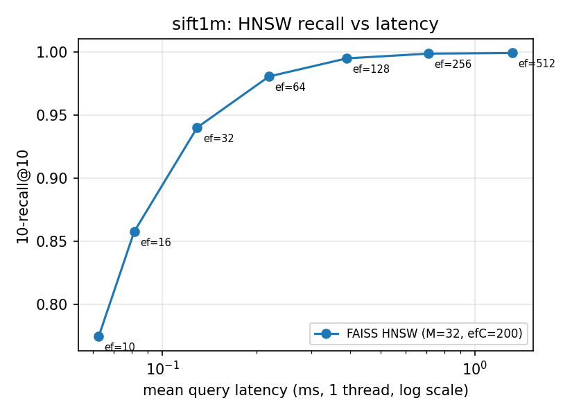
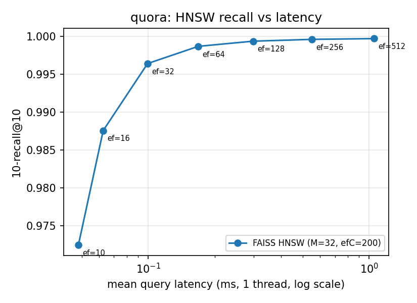
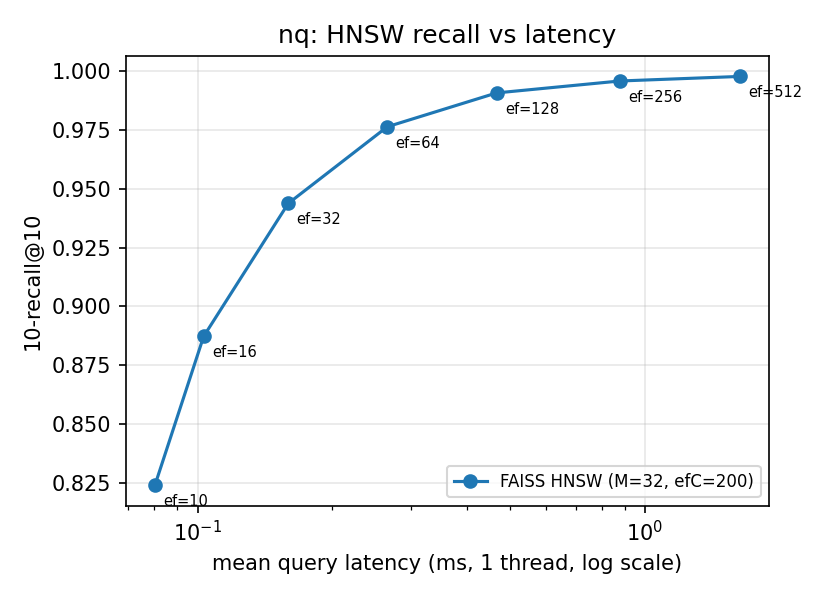
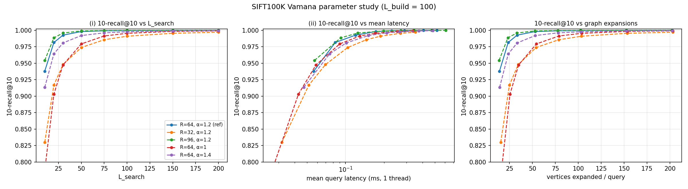
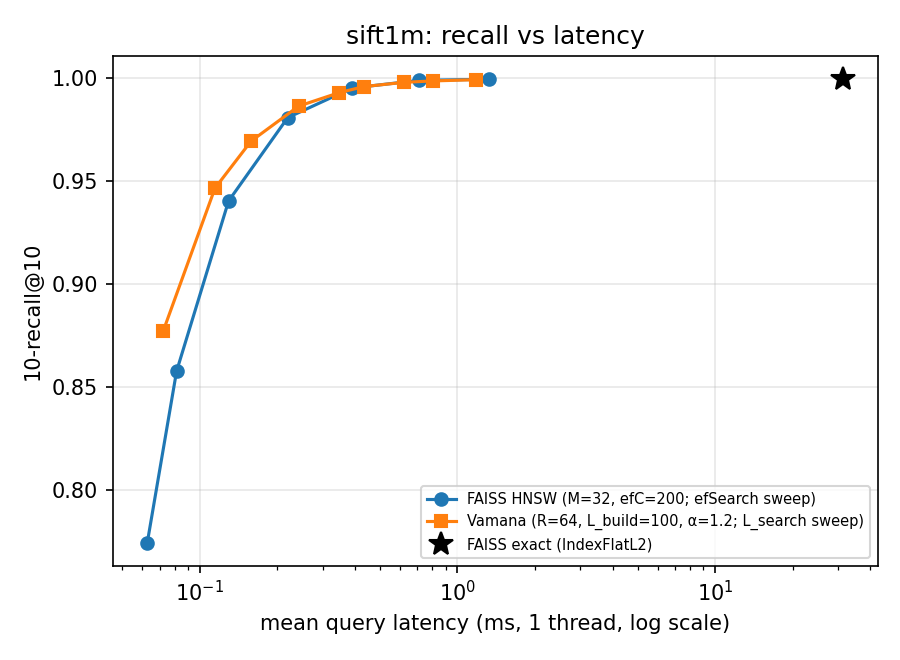
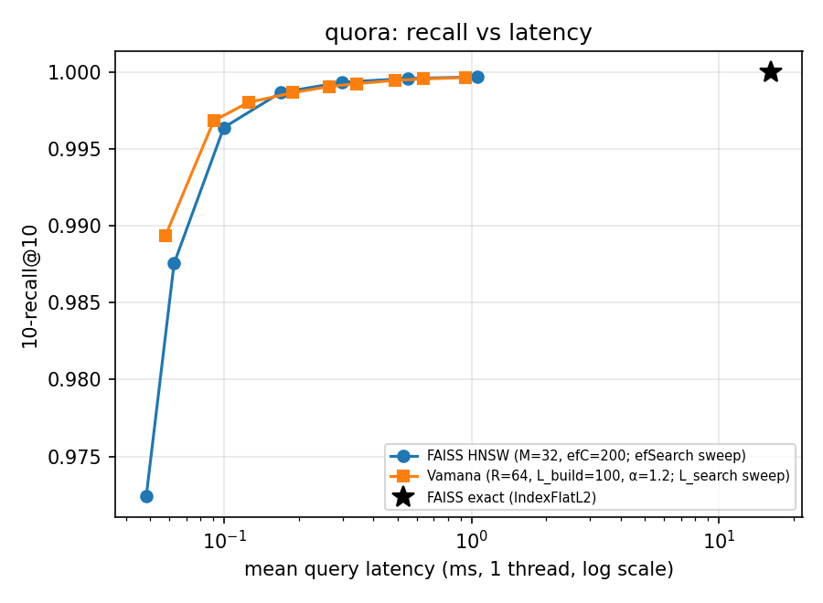
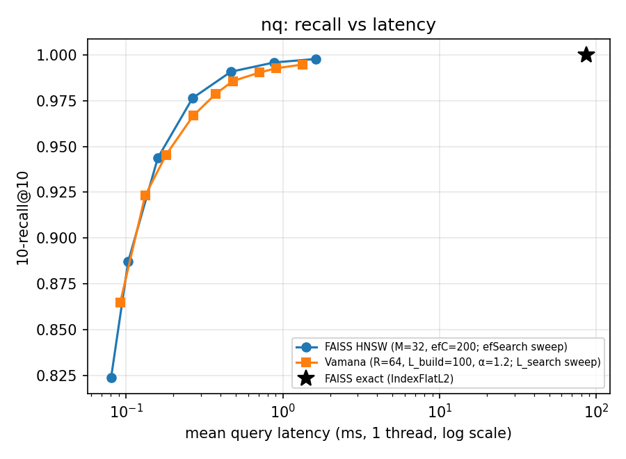

# CS6101 PA2 — Approximate Nearest Neighbour Search with Vamana / DiskANN

*Compulsory part (dataset preparation, Parts 1–3). Extra credit not attempted.*

## 0. Environment and measurement protocol

| item | value |
|---|---|
| CPU | 2 × AMD EPYC 7402 24-Core (48 cores / 96 hardware threads total), 251 GiB RAM, shared lab server |
| Storage | data and indices on NVMe SSD (Crucial CT1000P3PSSD8) |
| Software | Python 3.10.16, NumPy 2.2.6, FAISS-cpu 1.15.1, Numba 0.68.0 (OpenMP threading layer), scikit-learn 1.7.2 |
| Build threads | 48 for both FAISS HNSW and Vamana |
| Query threads | **1** for every method (FAISS `omp_set_num_threads(1)`; the Vamana search kernel is single-threaded) |
| Query mode | **one query at a time** (batch size 1), issued from Python for every method; k = 10 |
| Timing subset | fixed random subset of 1000 queries (seed 1234) for SIFT1M/Quora/NQ/SIFT100K. Recall is always computed over the **full** query set |
| Timing procedure | 100 untimed warm-up queries, then 5 timed passes over the 1000 queries; reported mean latency = median of the 5 per-pass means; p50/p95 are from the fastest pass; QPS = 1 / mean latency (single thread). One-time index loading is excluded |

The server is shared with other users, so the first runs were affected by other people's jobs. All latencies reported here were therefore **re-measured in one session by `retime.py`**. That process was pinned to the least-loaded core, and exact, HNSW and Vamana were timed back to back for each dataset. Recall, distance counts, build times and sizes come from the original runs, which are deterministic. Build times are wall-clock times on the shared machine and may vary by roughly ±20 % from run to run. For example, the same SIFT100K reference build took 10 s, 19.6 s and 18.6 s in three separate runs.

## 1. Dataset preparation

* **SIFT1M:** the texmex ftp mirror was unreachable from the server. I used the identical copy distributed by ann-benchmarks (`sift-128-euclidean.hdf5`), which has the same 1M base vectors, 10K queries and supplied top-100 ground truth. L2 distance.
* **SIFT100K:** the first 100,000 SIFT1M base vectors with all 10,000 SIFT queries. Exact top-100 ground truth was computed with FAISS `IndexFlatL2`.
* **Quora and NQ:** corpus embeddings and test-split query embeddings come from `CohereLabs/beir-embed-english-v3` (1024-d). I fit PCA on corpus vectors only, using a uniform random sample of 500,000 vectors (seed 42; for Quora this is 500K of 523K). The same fitted PCA projects both corpus and queries to 128 dimensions. The results are cast to float32 and L2-normalised. Exact top-100 ground truth comes from FAISS `IndexFlatL2` over these 128-d vectors, is saved to disk (`*_gt.npy`) and is reused everywhere. BEIR qrels are not used.

| dataset | corpus size | #queries | orig. dim | search dim | 128-d float32 (MiB) |
|---|---|---|---|---|---|
| sift1m | 1000000 | 10000 | 128 | 128 | 488.3 |
| sift100k | 100000 | 10000 | 128 | 128 | 48.83 |
| quora | 522931 | 10000 | 1024 | 128 | 255.3 |
| nq | 2681468 | 3452 | 1024 | 128 | 1,309 |


| dataset | PCA implementation | fit sample | seed | variance explained (128 comps) |
|---|---|---|---|---|
| quora | sklearn 1.7.2 PCA(n_components=128, svd_solver='covariance_eigh'), mean-centred | 500000 | 42 | 0.6174 |
| nq | sklearn 1.7.2 PCA(n_components=128, svd_solver='covariance_eigh'), mean-centred | 500000 | 42 | 0.5989 |


SIFT1M FAISS-exact vs supplied GT: top-1 agreement 0.9926, top-10 overlap 0.99935, top-100 overlap 0.99989; 74 top-1 mismatches, all exact distance ties: True.

## Part 1 — Exact search and HNSW with FAISS

**1a. Exact kNN.** I used `IndexFlatL2`. On SIFT1M, the FAISS results match the supplied ground truth for 99.26 % of top-1 answers and 99.935 % of top-10 entries. I checked every one of the 74 top-1 disagreements, and each one is an exact distance tie: SIFT1M contains duplicate base vectors, so tied neighbours can legitimately be ordered differently. As required, I keep the supplied ground truth for SIFT1M. Because of these ties, **no method can exceed about 0.993 1-recall@1 on SIFT1M**; even exact search scores 0.9926. Quora and NQ have the same effect on a smaller scale (near-duplicate questions and passages), which is why exact search shows 0.9999 or 0.99997 instead of 1.

**1b. HNSW.** I used `IndexHNSWFlat` with M = 32 (64 links on layer 0) and efConstruction = 200. These are common "good quality" defaults and were not tuned. I measured seven operating points, efSearch ∈ {10, 16, 32, 64, 128, 256, 512}. Index size is the size of the file written by `faiss.write_index`, which includes the vectors.

HNSW M=32, efConstruction=200, build threads 48.

| method | 1-R@1 | 10-R@10 | mean lat (ms) | p95 lat (ms) | QPS | build (s) | index (MiB) |
|---|---|---|---|---|---|---|---|
| FAISS exact (IndexFlatL2) | 0.9926 | 0.9993 | 31.27 | 31.72 | 31.98 | 0.1961 | 488.3 |
| HNSW efSearch=10 | 0.8419 | 0.7743 | 0.0626 | 0.0863 | 15,965 | 185.0 | 747.8 |
| HNSW efSearch=16 | 0.9062 | 0.8575 | 0.0814 | 0.1089 | 12,292 | 185.0 | 747.8 |
| HNSW efSearch=32 | 0.9599 | 0.9402 | 0.1295 | 0.1667 | 7,724 | 185.0 | 747.8 |
| HNSW efSearch=64 | 0.9834 | 0.9807 | 0.2196 | 0.2807 | 4,554 | 185.0 | 747.8 |
| HNSW efSearch=128 | 0.9910 | 0.9950 | 0.3899 | 0.4961 | 2,565 | 185.0 | 747.8 |
| HNSW efSearch=256 | 0.9924 | 0.9988 | 0.7101 | 0.9002 | 1,408 | 185.0 | 747.8 |
| HNSW efSearch=512 | 0.9926 | 0.9993 | 1.32 | 1.68 | 756.7 | 185.0 | 747.8 |

HNSW M=32, efConstruction=200, build threads 48.

| method | 1-R@1 | 10-R@10 | mean lat (ms) | p95 lat (ms) | QPS | build (s) | index (MiB) |
|---|---|---|---|---|---|---|---|
| FAISS exact (IndexFlatL2) | 0.9999 | 1.0000 | 16.23 | 16.29 | 61.62 | 0.1255 | 255.3 |
| HNSW efSearch=10 | 0.9894 | 0.9725 | 0.0483 | 0.0653 | 20,691 | 100.8 | 391.0 |
| HNSW efSearch=16 | 0.9947 | 0.9876 | 0.0626 | 0.0823 | 15,980 | 100.8 | 391.0 |
| HNSW efSearch=32 | 0.9976 | 0.9964 | 0.0994 | 0.1299 | 10,060 | 100.8 | 391.0 |
| HNSW efSearch=64 | 0.9986 | 0.9987 | 0.1686 | 0.2183 | 5,931 | 100.8 | 391.0 |
| HNSW efSearch=128 | 0.9990 | 0.9993 | 0.2983 | 0.3868 | 3,352 | 100.8 | 391.0 |
| HNSW efSearch=256 | 0.9991 | 0.9996 | 0.5506 | 0.7137 | 1,816 | 100.8 | 391.0 |
| HNSW efSearch=512 | 0.9993 | 0.9997 | 1.05 | 1.35 | 951.5 | 100.8 | 391.0 |

HNSW M=32, efConstruction=200, build threads 48.

| method | 1-R@1 | 10-R@10 | mean lat (ms) | p95 lat (ms) | QPS | build (s) | index (MiB) |
|---|---|---|---|---|---|---|---|
| FAISS exact (IndexFlatL2) | 1.00 | 1.0000 | 85.93 | 89.46 | 11.64 | 0.5230 | 1,309 |
| HNSW efSearch=10 | 0.8833 | 0.8239 | 0.0803 | 0.1170 | 12,458 | 457.9 | 2,005 |
| HNSW efSearch=16 | 0.9253 | 0.8872 | 0.1031 | 0.1502 | 9,696 | 457.9 | 2,005 |
| HNSW efSearch=32 | 0.9577 | 0.9438 | 0.1594 | 0.2196 | 6,272 | 457.9 | 2,005 |
| HNSW efSearch=64 | 0.9783 | 0.9764 | 0.2654 | 0.3671 | 3,767 | 457.9 | 2,005 |
| HNSW efSearch=128 | 0.9910 | 0.9908 | 0.4658 | 0.6407 | 2,147 | 457.9 | 2,005 |
| HNSW efSearch=256 | 0.9954 | 0.9959 | 0.8777 | 1.20 | 1,139 | 457.9 | 2,005 |
| HNSW efSearch=512 | 0.9980 | 0.9979 | 1.63 | 2.17 | 614.2 | 457.9 | 2,005 |

HNSW recall vs. latency: `plots/part1_hnsw_sift1m.png`, `plots/part1_hnsw_quora.png`, `plots/part1_hnsw_nq.png`.

  

Quora is by far the easiest dataset: ef = 10 already gives 0.97 10-recall@10. NQ is the hardest, because it has 2.7M points and the PCA-reduced text embeddings have low contrast between neighbours.

## Part 2 — Vamana implementation

### Implementation (`vamana.py`)

* **Language and libraries:** Python driver. All performance-critical code (GreedySearch, RobustPrune, the construction phases and batched search) is in Numba `@njit(fastmath=True)` functions compiled to native SIMD code, parallelised with `prange` on the OpenMP layer. FAISS is used only for the exact ground truth and the HNSW baseline. No existing Vamana or DiskANN code is used.
* **Graph representation:** a fixed-capacity adjacency matrix `nbrs: int32[N, R]` plus `deg: int32[N]`. Only the first `deg[i]` entries of a row are valid. Serialized form (`.graph`): header `[N, R, start]` (int32), then `deg`, then `nbrs`. The file is N·(R+1)·4 B.
* **GreedySearch:** follows the 2a pseudo-code. The candidate set C is a sorted array of at most L `(dist, id, expanded)` entries. New neighbours are inserted by binary search and shift, and the entry that falls past L is dropped. A cursor tracks the closest unexpanded candidate. The algorithm records the visited (expanded) set V with distances (used by construction) and counts **vertices expanded** and **distance evaluations**. Only previously unseen query-to-database distances are counted, because a per-thread "seen" stamp array prevents recomputing a distance.
* **RobustPrune:** follows the 2b pseudo-code. The candidate pool is V ∪ N_out(p), deduplicated with p removed, then sorted by distance to p. It repeatedly takes the closest surviving p\*, then removes every p′ with α·d(p\*, p′) ≤ d(p, p′), stopping at R. All distances are squared L2, so the test is evaluated as α²·d²(p\*, p′) ≤ d²(p, p′). This is exactly equivalent to the Euclidean condition.
* **Construction:** a random R-regular directed graph (exactly R distinct non-self out-neighbours per vertex, seeded). The entry point s is the database point nearest the dataset mean, used as the medoid approximation. There are two passes over a seeded random permutation: α = 1, then the chosen α. Every inserted point gets GreedySearch(s, x_p, L_build), then RobustPrune(p, V), then reverse edges j ← p, with RobustPrune(j, …) when |N_out(j) ∪ {p}| > R.
* **Parallelisation (lock-free, deterministic):** each pass processes the permutation in batches. In the first pass, batch sizes double from 1 up to min(2 % N, 50,000), similar to ParlayANN's prefix doubling; the second pass uses the maximum batch size. Each batch runs four phases:
  1. In parallel, each point runs GreedySearch and RobustPrune against the current graph and writes its new out-list into a private buffer.
  2. In parallel, these lists are written into the graph.
  3. Reverse edges are grouped by target j with a stable sort.
  4. In parallel over distinct j, the union is computed and pruned if it exceeds R.

  Each graph row is written by exactly one thread per phase, so no locks are needed, and the build is reproducible for a fixed seed. With batch size 1 this is literally the sequential pseudo-code. I checked this on a 10K subset: the strictly sequential build (batch size 1) and the batched build both give 10-recall@10 = 0.9965 at L_search = 20, with nearly the same average degree (46.99 vs 47.08).
* **Random seed:** 0, used for both graph initialisation and the permutations.
* **Major optimizations:** contiguous float32 vectors; compact int32 adjacency; distance loops compiled by Numba with fastmath (auto-vectorised AVX2); per-thread reusable buffers (the "seen" stamp arrays avoid clearing an N-sized visited set for each search; candidate, visited and pool buffers are allocated once per build); a sorted-array candidate list with binary-search insertion; lock-free batch-parallel construction on 48 threads; parallel `prange` search for recall evaluation; graph and indices persisted and reused.

### Changes from the reference configuration

None. All full graphs use **R = 64, L_build = 100, α = 1.2**. That configuration builds in minutes and gives HNSW-level recall, so there was no need to change it.

### Scaling study (before full builds)

| dataset | N | build (s) | avg deg | max deg | peak RSS (MiB) |
|---|---|---|---|---|---|
| sift1m | 100000 | 19.64 | 53.42 | 64 | 367.1 |
| sift1m | 250000 | 81.15 | 56.65 | 64 | 522.5 |
| sift1m | 500000 | 184.3 | 57.52 | 64 | 714.7 |
| nq | 100000 | 12.79 | 58.66 | 64 | 334.9 |
| nq | 250000 | 41.99 | 59.60 | 64 | 519.7 |
| nq | 500000 | 87.42 | 60.15 | 64 | 709.9 |

From 100K to 500K points, build time grows by 9.4× on SIFT and 6.8× on NQ for a 5× larger N. That is slightly super-linear, which matches the expected O(N log N)-like behaviour: search paths get longer as the graph grows. Extrapolating predicted about 400 s for SIFT1M and about 10–12 min for NQ (2.68M), so I judged the implementation ready for the full builds. The measured full builds took 340 s and 699 s.

### Full-dataset build statistics

| dataset | N | R | L_build | α | build (s) | avg deg | max deg | min deg | graph file (MiB) | graph+vectors (MiB) | peak build RSS (MiB) | max deg ≤ R |
|---|---|---|---|---|---|---|---|---|---|---|---|---|
| sift1m | 1000000 | 64 | 100 | 1.20 | 340.2 | 57.85 | 64 | 7 | 248.0 | 736.2 | 1,188 | True |
| quora | 522931 | 64 | 100 | 1.20 | 158.6 | 56.91 | 64 | 7 | 129.7 | 385.0 | 731.9 | True |
| nq | 2681468 | 64 | 100 | 1.20 | 698.6 | 61.04 | 64 | 5 | 664.9 | 1,974 | 2,770 | True |

* **Out-degree:** the build asserts that `deg.max() ≤ R`. The maximum out-degree equals exactly 64 on every graph, and no vertex exceeds R. Average degrees are 57–61 because RobustPrune with α = 1.2 often stops before reaching R.
* **Serialized size:** "graph file" is the adjacency only. "Graph + vectors" adds the 128-d float32 vectors needed at query time, which makes it the in-memory index size comparable to FAISS HNSW.
* **Peak build memory:** `ru_maxrss` of the dedicated build process. It includes the loaded vectors, the graph, 48 per-thread N-sized `uint32` "seen" arrays (48·N·4 B, which is 0.5 GiB for NQ), and the Python/Numba runtime (about 150 MiB). The build time excludes Numba JIT compilation, because a warm-up build runs first on 3,000 points.

### SIFT100K single-query sanity check (reference graph, L_search = 50)

- **query_id**: 0
- **L_search**: 50
- **exact_top10**: [36538, 36267, 2176, 3752, 68299, 49874, 882, 87578, 4009, 2837]
- **vamana_top10**: [36538, 36267, 2176, 3752, 68299, 49874, 882, 87578, 4009, 2837]
- **10-recall@10**: 1.0
- **vertices_expanded**: 52
- **distance_evaluations**: 1583
- **entry_point**: 34776

## Part 3a — Parameter study on SIFT100K

Graphs: reference (R = 64, α = 1.2), R ∈ {32, 96} with α = 1.2, and α ∈ {1.0, 1.4} with R = 64. All use L_build = 100. Each graph is swept over L_search ∈ {10, 20, 30, 50, 75, 100, 150, 200}.

| R | α | L_build | L_search | 1-R@1 | 10-R@10 | mean lat (ms) | QPS | dist evals/q | expanded/q | avg deg | build (s) |
|---|---|---|---|---|---|---|---|---|---|---|---|
| 64 | 1.20 | 100 | 10 | 0.9684 | 0.9379 | 0.0563 | 17,753 | 613.9 | 14.04 | 53.42 | 18.58 |
| 64 | 1.20 | 100 | 20 | 0.9911 | 0.9815 | 0.0830 | 12,042 | 885.8 | 23.53 | 53.42 | 18.58 |
| 64 | 1.20 | 100 | 30 | 0.9969 | 0.9928 | 0.1196 | 8,361 | 1,131 | 33.28 | 53.42 | 18.58 |
| 64 | 1.20 | 100 | 50 | 0.9991 | 0.9982 | 0.1721 | 5,810 | 1,564 | 53.03 | 53.42 | 18.58 |
| 64 | 1.20 | 100 | 75 | 0.9996 | 0.9993 | 0.2294 | 4,360 | 2,036 | 77.87 | 53.42 | 18.58 |
| 64 | 1.20 | 100 | 100 | 1.00 | 0.9996 | 0.2885 | 3,466 | 2,456 | 102.8 | 53.42 | 18.58 |
| 64 | 1.20 | 100 | 150 | 1.00 | 0.9999 | 0.4057 | 2,465 | 3,196 | 152.6 | 53.42 | 18.58 |
| 64 | 1.20 | 100 | 200 | 1.00 | 0.9999 | 0.5178 | 1,931 | 3,844 | 202.5 | 53.42 | 18.58 |
| 32 | 1.20 | 100 | 10 | 0.8613 | 0.8297 | 0.0317 | 31,535 | 362.8 | 15.36 | 31.53 | 14.48 |
| 32 | 1.20 | 100 | 20 | 0.9340 | 0.9170 | 0.0516 | 19,368 | 517.8 | 24.89 | 31.53 | 14.48 |
| 32 | 1.20 | 100 | 30 | 0.9597 | 0.9480 | 0.0696 | 14,360 | 656.9 | 34.48 | 31.53 | 14.48 |
| 32 | 1.20 | 100 | 50 | 0.9801 | 0.9740 | 0.1039 | 9,621 | 908.5 | 53.99 | 31.53 | 14.48 |
| 32 | 1.20 | 100 | 75 | 0.9878 | 0.9858 | 0.1453 | 6,880 | 1,190 | 78.68 | 31.53 | 14.48 |
| 32 | 1.20 | 100 | 100 | 0.9928 | 0.9911 | 0.1869 | 5,349 | 1,446 | 103.5 | 31.53 | 14.48 |
| 32 | 1.20 | 100 | 150 | 0.9966 | 0.9956 | 0.2689 | 3,719 | 1,905 | 153.3 | 31.53 | 14.48 |
| 32 | 1.20 | 100 | 200 | 0.9977 | 0.9972 | 0.3525 | 2,837 | 2,316 | 203.1 | 31.53 | 14.48 |
| 96 | 1.20 | 100 | 10 | 0.9800 | 0.9543 | 0.0571 | 17,512 | 756.2 | 13.61 | 60.45 | 19.57 |
| 96 | 1.20 | 100 | 20 | 0.9960 | 0.9887 | 0.0916 | 10,915 | 1,088 | 23.17 | 60.45 | 19.57 |
| 96 | 1.20 | 100 | 30 | 0.9986 | 0.9960 | 0.1249 | 8,008 | 1,385 | 32.97 | 60.45 | 19.57 |
| 96 | 1.20 | 100 | 50 | 0.9997 | 0.9991 | 0.1986 | 5,036 | 1,909 | 52.77 | 60.45 | 19.57 |
| 96 | 1.20 | 100 | 75 | 0.9999 | 0.9997 | 0.2700 | 3,703 | 2,474 | 77.64 | 60.45 | 19.57 |
| 96 | 1.20 | 100 | 100 | 1.00 | 0.9999 | 0.3425 | 2,919 | 2,974 | 102.6 | 60.45 | 19.57 |
| 96 | 1.20 | 100 | 150 | 1.00 | 0.9999 | 0.4730 | 2,114 | 3,848 | 152.4 | 60.45 | 19.57 |
| 96 | 1.20 | 100 | 200 | 1.00 | 0.9999 | 0.6073 | 1,647 | 4,609 | 202.3 | 60.45 | 19.57 |
| 64 | 1.00 | 100 | 10 | 0.8642 | 0.7868 | 0.0265 | 37,709 | 286.9 | 16.19 | 15.78 | 13.69 |
| 64 | 1.00 | 100 | 20 | 0.9442 | 0.9029 | 0.0428 | 23,381 | 412.9 | 25.47 | 15.78 | 13.69 |
| 64 | 1.00 | 100 | 30 | 0.9709 | 0.9475 | 0.0587 | 17,036 | 531.9 | 34.93 | 15.78 | 13.69 |
| 64 | 1.00 | 100 | 50 | 0.9897 | 0.9794 | 0.0900 | 11,107 | 757.8 | 54.30 | 15.78 | 13.69 |
| 64 | 1.00 | 100 | 75 | 0.9965 | 0.9915 | 0.1292 | 7,739 | 1,022 | 78.92 | 15.78 | 13.69 |
| 64 | 1.00 | 100 | 100 | 0.9980 | 0.9955 | 0.1705 | 5,864 | 1,267 | 103.7 | 15.78 | 13.69 |
| 64 | 1.00 | 100 | 150 | 0.9994 | 0.9985 | 0.2543 | 3,932 | 1,720 | 153.4 | 15.78 | 13.69 |
| 64 | 1.00 | 100 | 200 | 0.9997 | 0.9992 | 0.3360 | 2,976 | 2,135 | 203.2 | 15.78 | 13.69 |
| 64 | 1.40 | 100 | 10 | 0.9355 | 0.9133 | 0.0471 | 21,243 | 612.4 | 14.15 | 62.64 | 22.14 |
| 64 | 1.40 | 100 | 20 | 0.9739 | 0.9642 | 0.0750 | 13,331 | 864.6 | 23.65 | 62.64 | 22.14 |
| 64 | 1.40 | 100 | 30 | 0.9859 | 0.9809 | 0.1013 | 9,874 | 1,086 | 33.37 | 62.64 | 22.14 |
| 64 | 1.40 | 100 | 50 | 0.9948 | 0.9921 | 0.1510 | 6,621 | 1,474 | 53.08 | 62.64 | 22.14 |
| 64 | 1.40 | 100 | 75 | 0.9973 | 0.9962 | 0.2102 | 4,758 | 1,890 | 77.90 | 62.64 | 22.14 |
| 64 | 1.40 | 100 | 100 | 0.9986 | 0.9978 | 0.2656 | 3,764 | 2,258 | 102.8 | 62.64 | 22.14 |
| 64 | 1.40 | 100 | 150 | 0.9998 | 0.9991 | 0.3736 | 2,677 | 2,901 | 152.6 | 62.64 | 22.14 |
| 64 | 1.40 | 100 | 200 | 0.9998 | 0.9994 | 0.4828 | 2,071 | 3,462 | 202.5 | 62.64 | 22.14 |



*Left: (i) 10-recall@10 vs. L_search. Middle: (ii) 10-recall@10 vs. mean latency. Right: 10-recall@10 vs. vertices expanded per query.*

**Effect of L_search.** L_search is the only query-time knob. The number of vertices expanded is almost exactly L_search + 3 to 5 for every graph, because the search terminates only once all L candidates in the list have been expanded. Distance evaluations grow roughly linearly with L, and latency follows. Recall rises steeply up to L ≈ 30–50 and then saturates: going from L = 100 to 200 doubles the cost for ≤ 0.0004 recall on the reference graph.

**Effect of R.** A larger R gives every expansion more out-edges. That raises the cost per expansion (more distance evaluations: about 1.9K at L = 50 for R = 96 vs. 0.9K for R = 32), but it also raises the quality of each expansion. At the same L, the R = 96 graph reaches clearly higher recall than R = 64, which in turn beats R = 32. For example, at L = 20 the 10-recall@10 values are 0.989, 0.982 and 0.917. In latency terms, R = 32 is fastest only in the low-recall regime. To reach 10-recall@10 ≥ 0.99, R = 32 needs L = 100 (0.19 ms), while R = 64 needs L = 30 (0.12 ms) and R = 96 needs L = 30 (0.12 ms). Beyond R = 64 the gains are marginal, while memory and build time increase.

**Why more outgoing edges can mean fewer expansions.** Each expansion of a high-degree vertex evaluates more neighbours, so the candidate list fills with good candidates sooner. More importantly, the graph has smaller effective diameter and fewer local dead ends. GreedySearch can then move toward the query in larger steps and is less likely to get stuck in a local minimum where none of the current vertex's few neighbours is closer. With R = 96, 23 expansions reach 0.989 recall; with R = 32, about 103 expansions are needed to reach 0.991. Total work is roughly (expansions) × (degree). When the extra edges let the search converge in far fewer hops, a high-degree graph can win overall, even though each hop costs more.

**Effect of α.** With α = 1.0, RobustPrune keeps only "non-dominated" short edges, so the graph is very sparse (average degree 15.8). It is cheap per expansion, but it has no long-range shortcuts, so it needs many expansions: 0.903 recall at L = 20, against 0.982 for α = 1.2. Its latency curve is competitive only because each expansion is so cheap on this small, easy 100K dataset. With α = 1.2, more long-range edges survive (average degree 53), and recall per expansion improves sharply. With α = 1.4, almost every vertex saturates at R (average degree 62.6), but recall *drops* compared with α = 1.2 (0.964 vs. 0.982 at L = 20). Pruning has become so lax that the R slots fill with many long, redundant edges in similar directions, displacing short edges needed for the final local refinement. α trades navigability (long edges) against local precision (short edges), and on SIFT100K α = 1.2 is the best of the three.

## Part 3b — Full-dataset comparison

Each full dataset uses one Vamana graph (R = 64, L_build = 100, α = 1.2), with L_search swept on the finished graph. The FAISS numbers come from Part 1 and were re-timed in the same session.

| method | 1-R@1 | 10-R@10 | mean lat (ms) | p95 lat (ms) | QPS | dist evals/q | expanded/q | build (s) | graph+vectors (MiB) |
|---|---|---|---|---|---|---|---|---|---|
| Vamana L_search=10 | 0.9110 | 0.8771 | 0.0722 | 0.0949 | 13,843 | 779.4 | 15.82 | 340.2 | 736.2 |
| Vamana L_search=20 | 0.9578 | 0.9464 | 0.1146 | 0.1402 | 8,723 | 1,120 | 25.25 | 340.2 | 736.2 |
| Vamana L_search=30 | 0.9741 | 0.9692 | 0.1582 | 0.1893 | 6,321 | 1,438 | 34.89 | 340.2 | 736.2 |
| Vamana L_search=50 | 0.9858 | 0.9863 | 0.2422 | 0.2833 | 4,128 | 2,028 | 54.50 | 340.2 | 736.2 |
| Vamana L_search=75 | 0.9895 | 0.9928 | 0.3481 | 0.4164 | 2,873 | 2,700 | 79.24 | 340.2 | 736.2 |
| Vamana L_search=100 | 0.9911 | 0.9957 | 0.4325 | 0.5179 | 2,312 | 3,322 | 104.1 | 340.2 | 736.2 |
| Vamana L_search=150 | 0.9921 | 0.9978 | 0.6180 | 0.7516 | 1,618 | 4,458 | 153.9 | 340.2 | 736.2 |
| Vamana L_search=200 | 0.9928 | 0.9985 | 0.8038 | 0.9898 | 1,244 | 5,496 | 203.8 | 340.2 | 736.2 |
| Vamana L_search=300 | 0.9929 | 0.9991 | 1.18 | 1.47 | 846.9 | 7,373 | 303.6 | 340.2 | 736.2 |

| method | 1-R@1 | 10-R@10 | mean lat (ms) | p95 lat (ms) | QPS | dist evals/q | expanded/q | build (s) | graph+vectors (MiB) |
|---|---|---|---|---|---|---|---|---|---|
| Vamana L_search=10 | 0.9938 | 0.9894 | 0.0578 | 0.0761 | 17,299 | 628.6 | 15.57 | 158.6 | 385.0 |
| Vamana L_search=20 | 0.9972 | 0.9968 | 0.0905 | 0.1159 | 11,047 | 871.3 | 25.34 | 158.6 | 385.0 |
| Vamana L_search=30 | 0.9978 | 0.9980 | 0.1248 | 0.1592 | 8,010 | 1,098 | 35.20 | 158.6 | 385.0 |
| Vamana L_search=50 | 0.9983 | 0.9987 | 0.1894 | 0.2411 | 5,280 | 1,523 | 55.00 | 158.6 | 385.0 |
| Vamana L_search=75 | 0.9987 | 0.9991 | 0.2658 | 0.3458 | 3,762 | 2,020 | 79.85 | 158.6 | 385.0 |
| Vamana L_search=100 | 0.9988 | 0.9992 | 0.3418 | 0.4441 | 2,925 | 2,491 | 104.7 | 158.6 | 385.0 |
| Vamana L_search=150 | 0.9990 | 0.9995 | 0.4896 | 0.6376 | 2,042 | 3,381 | 154.6 | 158.6 | 385.0 |
| Vamana L_search=200 | 0.9990 | 0.9996 | 0.6389 | 0.8290 | 1,565 | 4,220 | 204.5 | 158.6 | 385.0 |
| Vamana L_search=300 | 0.9990 | 0.9996 | 0.9456 | 1.24 | 1,058 | 5,801 | 304.3 | 158.6 | 385.0 |

| method | 1-R@1 | 10-R@10 | mean lat (ms) | p95 lat (ms) | QPS | dist evals/q | expanded/q | build (s) | graph+vectors (MiB) |
|---|---|---|---|---|---|---|---|---|---|
| Vamana L_search=10 | 0.8847 | 0.8647 | 0.0917 | 0.1249 | 10,905 | 909.3 | 19.03 | 698.6 | 1,974 |
| Vamana L_search=20 | 0.9316 | 0.9231 | 0.1322 | 0.1783 | 7,564 | 1,235 | 28.92 | 698.6 | 1,974 |
| Vamana L_search=30 | 0.9519 | 0.9455 | 0.1798 | 0.2396 | 5,561 | 1,534 | 38.78 | 698.6 | 1,974 |
| Vamana L_search=50 | 0.9690 | 0.9668 | 0.2679 | 0.3555 | 3,732 | 2,087 | 58.50 | 698.6 | 1,974 |
| Vamana L_search=75 | 0.9794 | 0.9789 | 0.3738 | 0.4920 | 2,675 | 2,735 | 83.27 | 698.6 | 1,974 |
| Vamana L_search=100 | 0.9855 | 0.9858 | 0.4800 | 0.6340 | 2,083 | 3,350 | 108.1 | 698.6 | 1,974 |
| Vamana L_search=150 | 0.9887 | 0.9904 | 0.7100 | 0.9288 | 1,409 | 4,506 | 157.8 | 698.6 | 1,974 |
| Vamana L_search=200 | 0.9919 | 0.9928 | 0.9065 | 1.24 | 1,103 | 5,602 | 207.5 | 698.6 | 1,974 |
| Vamana L_search=300 | 0.9928 | 0.9948 | 1.34 | 1.85 | 745.1 | 7,665 | 307.2 | 698.6 | 1,974 |

  

### Compact comparison at comparable recall

For each target, the row shows the **cheapest** (lowest mean latency) operating point of each method whose 10-recall@10 is ≥ the target. HNSW index size = FAISS file (graph + vectors); Vamana index size = graph file + float32 vectors.

| dataset | target 10-R@10 | method | 1-R@1 | 10-R@10 | mean lat (ms) | QPS | build (s) | index (MiB) | dist evals/q | expanded/q | speed-up vs exact |
|---|---|---|---|---|---|---|---|---|---|---|---|
| sift1m | — | FAISS exact | 0.9926 | 0.9993 | 31.27 | 31.98 | 0.1961 | 488.3 |  |  | 1.00 |
| sift1m | 0.9500 | HNSW ef=64 | 0.9834 | 0.9807 | 0.2196 | 4,554 | 185.0 | 747.8 |  |  | 142.4 |
| sift1m | 0.9500 | Vamana L=30 | 0.9741 | 0.9692 | 0.1582 | 6,321 | 340.2 | 736.2 | 1,438 | 34.89 | 197.6 |
| sift1m | 0.9900 | HNSW ef=128 | 0.9910 | 0.9950 | 0.3899 | 2,565 | 185.0 | 747.8 |  |  | 80.19 |
| sift1m | 0.9900 | Vamana L=75 | 0.9895 | 0.9928 | 0.3481 | 2,873 | 340.2 | 736.2 | 2,700 | 79.24 | 89.82 |
| sift1m | 0.9950 | HNSW ef=128 | 0.9910 | 0.9950 | 0.3899 | 2,565 | 185.0 | 747.8 |  |  | 80.19 |
| sift1m | 0.9950 | Vamana L=100 | 0.9911 | 0.9957 | 0.4325 | 2,312 | 340.2 | 736.2 | 3,322 | 104.1 | 72.30 |
| quora | — | FAISS exact | 0.9999 | 1.0000 | 16.23 | 61.62 | 0.1255 | 255.3 |  |  | 1.00 |
| quora | 0.9500 | HNSW ef=10 | 0.9894 | 0.9725 | 0.0483 | 20,691 | 100.8 | 391.0 |  |  | 335.8 |
| quora | 0.9500 | Vamana L=10 | 0.9938 | 0.9894 | 0.0578 | 17,299 | 158.6 | 385.0 | 628.6 | 15.57 | 280.7 |
| quora | 0.9900 | HNSW ef=32 | 0.9976 | 0.9964 | 0.0994 | 10,060 | 100.8 | 391.0 |  |  | 163.3 |
| quora | 0.9900 | Vamana L=20 | 0.9972 | 0.9968 | 0.0905 | 11,047 | 158.6 | 385.0 | 871.3 | 25.34 | 179.3 |
| quora | 0.9950 | HNSW ef=32 | 0.9976 | 0.9964 | 0.0994 | 10,060 | 100.8 | 391.0 |  |  | 163.3 |
| quora | 0.9950 | Vamana L=20 | 0.9972 | 0.9968 | 0.0905 | 11,047 | 158.6 | 385.0 | 871.3 | 25.34 | 179.3 |
| nq | — | FAISS exact | 1.00 | 1.0000 | 85.93 | 11.64 | 0.5230 | 1,309 |  |  | 1.00 |
| nq | 0.9500 | HNSW ef=64 | 0.9783 | 0.9764 | 0.2654 | 3,767 | 457.9 | 2,005 |  |  | 323.7 |
| nq | 0.9500 | Vamana L=50 | 0.9690 | 0.9668 | 0.2679 | 3,732 | 698.6 | 1,974 | 2,087 | 58.50 | 320.7 |
| nq | 0.9900 | HNSW ef=128 | 0.9910 | 0.9908 | 0.4658 | 2,147 | 457.9 | 2,005 |  |  | 184.5 |
| nq | 0.9900 | Vamana L=150 | 0.9887 | 0.9904 | 0.7100 | 1,409 | 698.6 | 1,974 | 4,506 | 157.8 | 121.0 |
| nq | 0.9950 | HNSW ef=256 | 0.9954 | 0.9959 | 0.8777 | 1,139 | 457.9 | 2,005 |  |  | 97.91 |
| nq | 0.9950 | Vamana: not reached |  |  |  |  |  |  |  |  |  |

### Discussion

**Recall vs. latency.** Both graph indices are 70–340× faster than exact search at ≥ 0.95 10-recall@10, and still 70–180× faster at ≥ 0.99. The two curves lie close together on all three datasets.

* **SIFT1M and Quora:** the two methods are within about ±10 % of each other. My Vamana is slightly ahead at the 0.95 and 0.99 targets: SIFT1M at 0.99, Vamana L = 75 takes 0.35 ms vs. HNSW ef = 128 at 0.39 ms; Quora at 0.99, 0.091 ms vs. 0.099 ms. HNSW is slightly ahead at 0.995 on SIFT1M (0.39 ms vs. 0.43 ms). On Quora's low-recall end, Vamana's smallest setting (L = 10) already reaches 0.989, so its cheapest point is more accurate but a little slower than HNSW ef = 10.
* **NQ, low recall:** Vamana degrades more gracefully. L = 10 gives 0.865 at 0.092 ms, while HNSW ef = 10 gives 0.824 at 0.080 ms.
* **NQ, high recall:** HNSW is clearly better. It is 1.5× faster at 0.99 (0.47 ms vs. 0.71 ms), and it reaches 0.995, which Vamana does not reach within L_search ≤ 300 (0.9948 at L = 300).

Two factors explain HNSW's advantage at the high-recall end:

1. **Implementation:** FAISS's search loop is hand-tuned C++ with SIMD distance kernels and prefetching. My kernel is Numba-generated and costs about 120–130 ns per distance evaluation, including candidate-list maintenance.
2. **Algorithm:** HNSW's upper layers deliver a query-specific starting point close to the target. Vamana always starts from one fixed medoid and spends part of its L budget walking from the dataset centre. This hurts most on the large, high-intrinsic-dimension NQ set.

Vamana's distance-evaluation and expansion counters are given in the tables. Expansions are about L_search + 4 to 8. Each expansion performs about 25–50 new distance evaluations: more at small L, fewer at large L, where more neighbours have already been seen. These counts are independent of machine noise.

**Build time.** On 48 threads, Vamana takes 340 s, 159 s and 699 s for SIFT1M, Quora and NQ, against 185 s, 101 s and 458 s for FAISS HNSW (efConstruction = 200). Vamana builds are therefore about 1.5–1.8× slower. Two reasons:

* Vamana does **two full passes**, each with a search at L_build = 100 per point.
* RobustPrune is re-run on every overflowing reverse neighbour list, which costs O(|C|·R) distances per prune. This is the dominant cost of pass 2: pass 2 takes about 1.6–1.9× as long as pass 1.

HNSW builds in a single pass. Using α = 1.0, a smaller L_build, or a slack factor (allowing up to 1.3R before pruning, as the DiskANN code does) would cut Vamana build time at some cost in quality.

**Index size.** Vamana stores a flat single-layer graph: N·(R+1)·4 B, which is 248 MiB for SIFT1M and 665 MiB for NQ. Adding the 128-d float32 vectors gives 736 MiB and 1,974 MiB. FAISS HNSW stores 748 MiB and 2,005 MiB: 2M links on layer 0, plus upper levels, plus per-level offsets, plus the vectors. The two are therefore about the same size at R = 2M = 64. Vamana's fixed-stride layout is what makes DiskANN's SSD layout possible: a vertex's vector and its neighbour list can be placed in one fixed-size disk record addressed by ID, with no hierarchy.

**Overall.** My Vamana implementation matches FAISS HNSW on SIFT1M and Quora at the same index size, and on NQ it is up to 1.5× slower at the highest recall targets. All query-side work runs in Numba rather than hand-tuned C++. The cost is a 1.5–1.8× longer build.

## Files

| file | purpose |
|---|---|
| `common.py` | paths, recall@k, timing protocol, helpers |
| `prepare_data.py` | SIFT1M/SIFT100K/Quora/NQ preparation, PCA, exact GT |
| `part1_faiss.py` | Part 1: FAISS exact + HNSW |
| `vamana.py` | **own** GreedySearch, RobustPrune, Vamana build, search, serialization |
| `part2_build.py` | Part 2: scaling study, full builds, sanity check |
| `part3.py` | Part 3a parameter study, Part 3b comparison |
| `retime.py` | one-session re-timing of all latencies |
| `make_tables.py`, `build_report.py` | results JSON → tables → this report |
| `run_all.sh` | runs the full pipeline after `prepare_data.py` |
| `results/*.json`, `plots/*.png`, `logs/` | raw results, figures, logs |

Reproduce:

```
python3.10 -m venv .venv && .venv/bin/pip install numpy faiss-cpu numba scikit-learn matplotlib pandas pyarrow huggingface_hub psutil h5py
python prepare_data.py all && ./run_all.sh && python retime.py && python make_tables.py && python build_report.py
```

Datasets and indices live in `data/`, which is a symlink to the NVMe disk and is not included in the submission.

## LLM usage

This assignment was implemented with the help of **Claude Code (Anthropic Claude, CLI agent)**. Given the assignment PDF, it set up the environment and downloaded and prepared the data. It wrote all scripts in this submission, including the Vamana implementation in `vamana.py`, ran all experiments, and drafted this report. While doing so it found and fixed a reverse-edge bug in which out-degree could exceed R. The student reviewed the work and is responsible for it.

*Shareable chat/session link(s): **TODO — add link(s) here before submission.***
